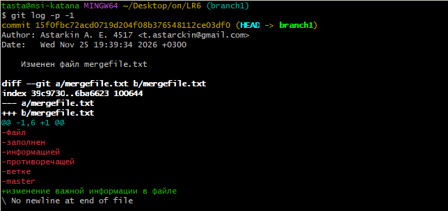
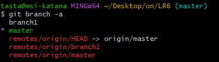
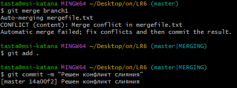
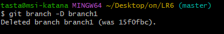
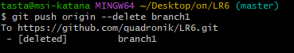
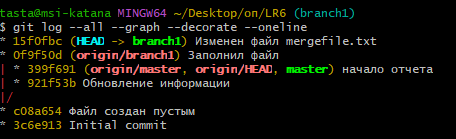
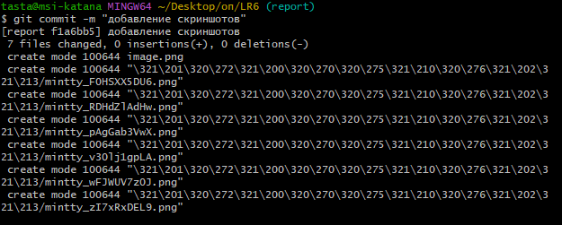
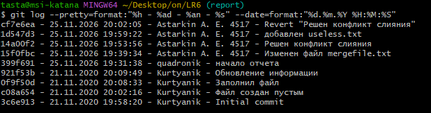

# LR6
Лабораторная работа №6

Цель лабораторной работы: изучение базовых возможностей системы
управления версиями, опыт работы с Git Api, опыт работы с локальным и
удаленным репозиторием.

## Содержание
1. [Форк репозитория LR6](#форк-репозитория-lr6)
2. [Установка Git](#установка-git)
3. [Клонирование репозитория](#клонирование-репозитория)
4. [Добавление файла в GitHub и подтягивание изменений](#добавление-файла-в-github-и-подтягивание-изменений)
5. [История операций для каждой из веток](#история-операций-для-каждой-из-веток)
6. [Просмотр последних изменений](#просмотр-последних-изменений)
7. [Слияние веток и разрешение конфликтов](#слияние-веток-и-разрешение-конфликтов)
8. [Удаление побочной ветки](#удаление-побочной-ветки)
9. [Откат коммита](#откат-коммита)
10. [Создание ветки для отчёта](#создание-ветки-для-отчёта)
11. [История операций в отчёте](#история-операций-в-отчёте)
12. [Выводы](#выводы)

## Форк репозитория LR6
1. Переходим на страницу репозитория [LR6](https://github.com/Kurtyanik/LR6)

2. Нажимаем кнопку "Fork" в правом верхнем углу страницы.

## Установка Git
1. Скачиваем установщик Git с [официального сайта](https://git-scm.com/).

2. Запускаем установщик и следуем инструкциям.

3. Настраиваем имя пользователя и email:
```bash
git config --global user.name "Astarkin A. E. 4517"
git config --global user.email astarckin@gmail.com
```

## Клонирование репозитория
1. Клонируем репозиторий на локальную машину:
```bash
git clone https://github.com/quadronik/LR6
```

## Добавление файла в GitHub и подтягивание изменений
1. Нажатием кнопки "Add file" -> "Upload files" добавляем файл в репозиторий.

2. Подтягиваем изменения на локальную машину:
```bash
git pull
```

## История операций для каждой из веток
1. Получил историю коммитов для всех веток с помощью команды:
```bash
git log --all --graph --decorate --oneline
```


## Просмотр последних изменений
1. Для просмотра изменений последнего коммита выполнил:
```bash
git log -p -1
```



## Слияние веток и разрешение конфликтов
1. Переключился на ветку `master`:
```bash
git checkout master
```

2. Вывел список веток:
```bash
git branch -a
```




3. Отредактировал файл merge.txt


4. Слил ветку `feature` в ветку `master`:
```bash
git merge feature
```

5. Разрешил конфликт в файле [merge.txt](merge.txt)(принял версию из ветки `branch1`).



## Удаление побочной ветки
1. Убедился, что нахожусь в ветке `master`.

2. Удалил локальную ветку:
```bash
git branch -D branch1
```



3. Удалил удаленную ветку:
```bash
git push origin --delete branch1
```



## Откат коммита
1. Получил историю коммитов:
```bash
git log --oneline
```



2. Отменил изменения коммита, добавляющего useless.txt, при помощи revert:
```bash
git revert 15f0fbc
```

## Создание ветки для отчёта
1. Создал новую ветку report и переключился на неё:
```bash
git checkout -b report
```
2. Добавление папки со скриншотами.



## История операций в отчёте
1. Получил историю коммитов в форматированном виде и добавил её в отчёт:
```bash
git log --pretty=format:"%h - %ad - %an - %s" --date=format:"%d.%m.%Y %H:%M:%S"
```



## Лог комманд
```bash
git clone https://github.com/quadronik/coffee_room_bot.git
git remote add origin https://github.com/quadronik/coffee_room_bot.git
git clone https://github.com/quadronik/LR6.git
git config --global user.name "Astarkin A. E. 4517"
git clone https://github.com/quadronik/LR6.git
git switch -f branch1
git add .
git commit -m "Изменен файл mergefile.txt"
git log --all --graph --decorate --oneline
git log -p -1
git switch master
git branch -a
git merge branch1
git add .
git commit -m "Решен конфликт слияния"
git branch -D branch1
git push origin --delete feature
git push origin --delete branch1
git add .
git commit -m "добавлен useless.txt"
git log --oneline
git revert 14a00f2
git revert -m 1 14a00f2
git log --oneline
git switch -b report
git chekout -b report
git checkout -b report
git log --pretty=format:"%h - %ad - %an - %s" --date=format:"%d.%m.%Y %H:%M:%S"
git add .
git commit -m "добавлена папка со скриншотами"
git add .
git commit -m "добавление скриншотов"
git add .
git commit -m "изменения в отчете"
git add .
git commit -m "изменения в отчете"
git push -u origin report
git add .
git commit -m "Изменения в отчете"
git push -u origin report
git add .
git commit -m "Удаление ненужных файлов"
git push -u origin report
```

## Вывод
В данной лабораторной работе были изучены базовые возможности системы управления версиями, был получен опыт работы с Git Api и опыт работы с локальным и удаленным репозиторие, также был получен опыт работы с Markdown
